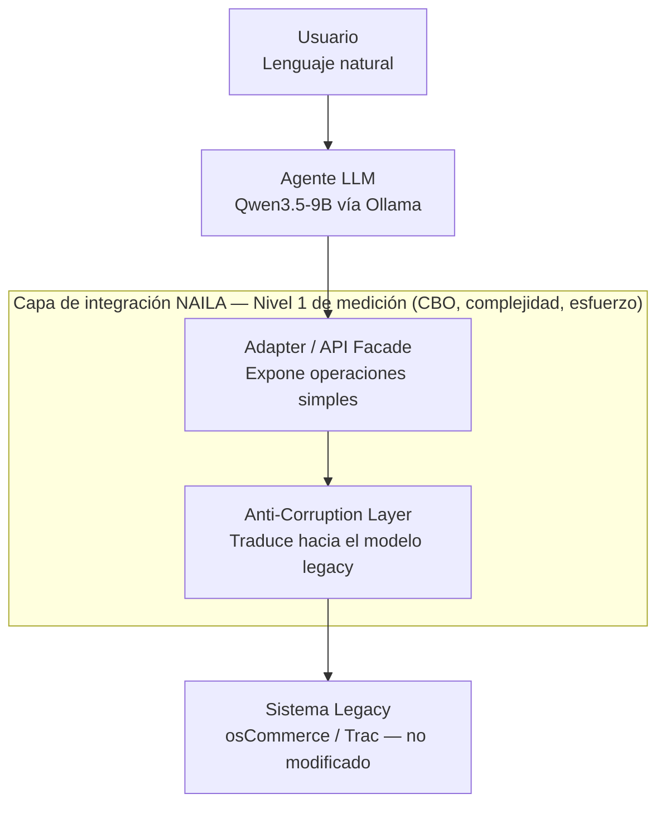

# Arquitectura NAILA — Documento de Referencia

## Diagrama de capas

## Contratos de datos entre capas (actualizado Día 15 — coherente con implementación real)

| Frontera | Formato del mensaje | Ejemplo real (osCommerce, Día 14) |
|---|---|---|
| Usuario → Agente LLM | Texto libre en lenguaje natural | `"muéstrame los productos disponibles"` |
| Agente LLM → Adapter/Facade | Formato nativo de tool calling de Ollama: `{"function": {"name": ..., "arguments": {...}}}` | `{"function": {"name": "list_available_products", "arguments": {}}}` |
| Adapter/Facade → ACL | Llamada directa a método Python | `self.acl.get_available_products(limit=10)` |
| ACL → Sistema Legacy | Consulta SQL de solo lectura sobre la base de datos del sistema legacy | `SELECT products_id, products_model, products_price, products_quantity FROM products WHERE products_status = 1` |
| Sistema Legacy → ACL | Filas crudas de la tabla nativa | `{"products_id": 1, "products_model": "MG200MMS", ...}` |
| ACL → Adapter → Agente → Usuario | Objeto canónico limpio, sin exponer el esquema interno del legacy | `{"id": 1, "model": "MG200MMS", "price": 299.99, "stock": 32}` |

**Nota metodológica:** el contrato entre Agente LLM y Adapter no es un JSON "libre" diseñado por NAILA, sino el formato de tool calling nativo del proveedor del modelo (Ollama). Esto es una decisión de diseño válida y coherente con ADR-006 (usar tool calling nativo, sin framework de orquestación adicional) — se documenta aquí para que la tesis no describa un contrato ficticio distinto al implementado.

## Definición de la capa de integración medible (Nivel 1)

Ver `operacionalizacion-variables.md` para la definición operacional completa. En resumen: todo el código dentro de `integracion-naila/` e `integracion-adhoc/` en cada caso de estudio — en la implementación actual de osCommerce, esto corresponde a `oscommerce_acl.py` y `oscommerce_adapter.py`.

## Estado de implementación (actualizado Día 15)

| Caso de estudio | Adapter/ACL (NAILA) | Ad hoc (baseline) | Casos de uso implementados |
|---|---|---|---|
| osCommerce | ✅ Funcional | ⏳ Pendiente (Fase 3) | `list_available_products` |
| Trac | ⏳ Pendiente (Fase 3) | ⏳ Pendiente (Fase 3) | Ninguno aún |
